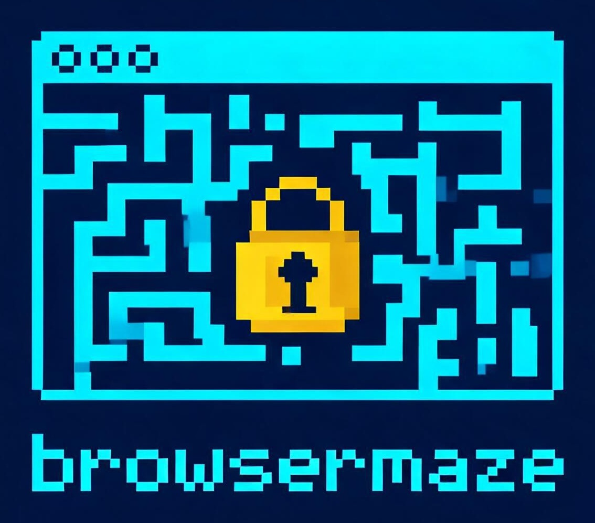

<p align="center">
  
</p>

# browsermaze

A pool of logged-in Chrome browsers for coding agents.

## What it does for you

Your agent needs a real browser to test an app that sits behind a sign-in. browsermaze gives it one:

- **Already logged in.** You log in to your sites once, in Chrome on your Mac or Linux desktop. Every browser the agent gets starts with those logins.
- **Several at once.** A Linux machine runs a few browsers, called slots. Agents on different tasks each lease their own slot and do not share state.
- **Standard tools.** Each slot is a Chrome with a DevTools Protocol (CDP) port. Playwright and Playwright MCP connect to it, and a slot can record a video of the session.

An agent leases a slot over SSH, drives it, and releases it. [autonomouse](https://github.com/riodeuno/autonomouse) uses the pool through its `browser.pool` setting.

## What you need

- A Linux machine for the pool: Ubuntu 24.04 or 26.04 with systemd and an SSH server, x86_64 or arm64.
- Your Mac or Linux desktop, with Google Chrome, to log in to your sites.
- The SSH public key of your Mac or Linux desktop, so it can log in to the pool.

## Set up

### 1. The pool (Linux)

On the Linux machine:

```
git clone https://github.com/riodeuno/browsermaze
cd browsermaze
bash setup.sh
```

`setup.sh` runs as your user and calls `sudo` where it needs root. It asks four questions, once each; [Configuration](#configuration) lists them. To skip the questions, pass the answers as flags:

```
bash setup.sh --bind 127.0.0.1 --slots 4 --caller alice --authorize-key "$(cat worker.pub)"
```

Pass the public key of your Mac or Linux desktop with `--authorize-key`. The last output is a checklist with a `fix:` line for each failure. Running `setup.sh` again changes nothing that is already in place.

### 2. Your logins (Mac or Linux desktop)

On your Mac or Linux desktop, install the `browsermaze` command and run `browsermaze login`:

```
git clone https://github.com/riodeuno/browsermaze
cd browsermaze
bash setup.sh --pool alice@192.0.2.7
browsermaze login
```

On a Linux desktop, add `--role login` to `setup.sh`: Linux installs the pool by default.

`--pool` is the pool's SSH destination: anything `ssh` accepts, such as `user@host` or a host alias from `~/.ssh/config`. Add `--ssh-key PATH` when your SSH config names no identity file. Keep the checkout: the `browsermaze` link in `~/.local/bin` points into it.

Then, in `browsermaze login`:

1. Log in to each site the agents need, in the Chrome that opens. Leave one tab open on each site: cookies from every site are copied, but site storage only from open tabs.
2. Choose **Update the browser pool**.

Slots leased after the update get the new logins. Slots already leased keep the old ones. A service that rejects imported logins needs a login on the pool itself; see [VNC login](docs/how-it-works.md#logging-in-on-the-pool-through-vnc).

## Use the pool

### Commands

Agents run these over SSH as the caller login:

| To | Run |
|---|---|
| Take a slot | `ssh alice@host browsermaze lease` prints `N http://<address>:930N` |
| Drive it | Playwright `chromium.connectOverCDP('http://<address>:930N')`, or Playwright MCP with `--cdp-endpoint http://<address>:930N`. Use the context that is already open, `browser.contexts()[0]`: it holds the logins |
| Record it | `browsermaze record start N`, then `browsermaze record stop N`, which prints the `.mp4` path under `/srv/browsers/videos` |
| Give the slot back | `browsermaze release N` |
| See the slots | `browsermaze status` |
| See which sites are logged in | `browsermaze logins` prints one site per line |

### With autonomouse

Set the pool to the caller login and the pool's address or SSH alias:

```
autonomouse config set browser.pool alice@192.0.2.7
```

autonomouse runs `browsermaze lease` over SSH and connects to the address it prints, so `POOL_BIND` must be an address autonomouse can reach. When autonomouse runs on the pool machine itself, `127.0.0.1` is right.

## Configuration

The pool's `setup.sh` takes these settings. Each has a flag and an environment variable. To change one later, run `setup.sh` again with the flag.

| Setting | Flag | Environment variable | Default |
|---|---|---|---|
| The address the CDP ports listen on | `--bind ADDRESS` | `POOL_BIND` | `127.0.0.1`. Use this machine's own LAN address when agents run on other machines |
| The number of slots, 1 to 9 | `--slots N` | `POOL_SLOTS` | `4` |
| The login that leases slots | `--caller LOGIN` | `POOL_CALLER` | The user running `setup.sh`. Created when missing |
| Public keys allowed to log in as that login | `--authorize-key KEY`, repeatable | `POOL_AUTHORIZE_KEYS`, one key per line | None |

`--role pool|login` (`BROWSERMAZE_ROLE`) picks what `setup.sh` installs. The default is `pool` on Linux and `login` on macOS; `pool` needs Linux, and `login` works on both. On your Mac or Linux desktop, `setup.sh` takes `--pool` (`POOL_SSH`) and `--ssh-key` (`POOL_SSH_KEY`). The config files and the order in which answers win are in [How it works](docs/how-it-works.md#config-files).

## Version

`setup.sh --version` and `browsermaze version` print the version. [CHANGELOG.md](CHANGELOG.md) lists the changes.

## Security

The CDP ports have no authentication. Whoever can reach port `930N` controls a logged-in browser. The default `POOL_BIND=127.0.0.1` keeps the ports on the pool machine, which is right when the agents run there too. A pool on a LAN needs a firewall that allows ports `9301` to `930N` only from the worker machines. `setup.sh` does not manage the firewall. With ufw and its default of denying incoming connections, one worker at `192.0.2.10` and four slots:

```
sudo ufw allow from 192.0.2.10 to any port 9301:9304 proto tcp
```

## Learn more

- [How it works](docs/how-it-works.md): slots, leases, the golden profile, what `setup.sh` installs, config files, tests.
- [CHANGELOG.md](CHANGELOG.md): what changed in each version.

## License

MIT. See `LICENSE`.
